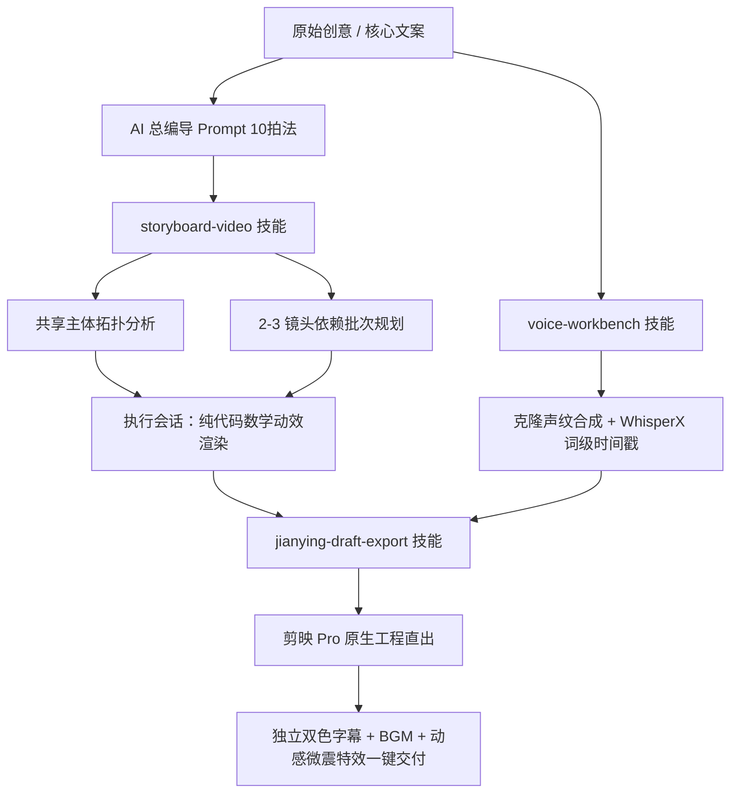

# LLM Video Skills Suite (大模型视频编导与剪映自动化 Skills 工具集)

[](LICENSE)
[](skills/storyboard-video/)
[](skills/jianying-draft-export/)
[](SKILL.md)

> **为 AI 编导大模型（Claude 3.5 Sonnet / GPT-4o / Grok / Gemini）量身打造的全流程视频生产与自动化剪辑 Skills 套件。**  
> 涵盖故事板全片规划、多镜头依赖拓扑、批次执行流、语音声纹锚点对齐，以及一键将代码母版与音轨装配为 **剪映 Pro 11.4+ 原生全轨道工程** 的无损桥梁。

---

## 🌟 核心能力矩阵 (Skill Matrix)



---

## 📦 技能模块概览

### 1. `storyboard-video`（故事板编导与批次拆解 Skill）
- **路径**：[`skills/storyboard-video/`](skills/storyboard-video/)
- **功能**：
  - **总览整片**：自动解析全部分镜故事板，建立共享主体矩阵与连续形变方案对比表。
  - **拓扑依赖管理**：区分独立镜头与强依赖前镜尾帧的连续镜头，安排并行开发批次。
  - **双会话协作协议**：维持长期的“导演会话（看整片、拆任务、把关质感）”与短上下文的“执行会话（连续完成 2~3 镜）”。

### 2. `jianying-draft-export`（剪映 Pro 原生草稿导出 Skill）
- **路径**：[`skills/jianying-draft-export/`](skills/jianying-draft-export/)
- **功能**：
  - **零媒体丢失报错**：自包含编译级 `libjycodec.dylib`，直接向 macOS 剪映草稿库写入合规 SQLite/JSON 索引。
  - **全轨道智能装配**：主视频母版轨（Clean Feed 纯净无字）、独立配音轨、环境音/BGM 轨、香槟金（`#ffd76a`）高光关键词独立字幕轨。
  - **秒级自动唤醒**：导出完成后自动调用系统进程唤醒剪映 Pro，创作者开箱即做最终微调。

### 3. `prompts/ai-director-sop`（AI 影视编导提示词工业化模板）
- **路径**：[`prompts/ai-director-sop.md`](prompts/ai-director-sop.md)
- **功能**：
  - **语言全损压缩算法**：将平铺直叙的文字转化为高密度、穿透力极强的冷峻商业哲学台词。
  - **10 拍黄金结构**：悬崖(0-3s) → 幻觉 → 齿轮 → 倾斜 → 死锁 → 回旋 → 裂缝 → 武器 → 锚点 → 余音(60s)。

### 4. `pipelines/voice-workbench`（配音对齐工作流）
- **路径**：[`pipelines/voice-workbench/`](pipelines/voice-workbench/)
- **功能**：
  - 豆包、CosyVoice、Fish Audio 声音锚点特征提取与复用。
  - 配合 WhisperX 提取毫秒级词粒度（Word-level）时间戳，自动生成严格对齐的 `subtitles.json`。

### 5. `showcases/agi-debt-video`（实战工程案例）
- **路径**：[`showcases/agi-debt-video/`](showcases/agi-debt-video/)
- **功能**：
  - 《被看见的负债 · 抗周期心力特别篇》全流程母版工程（ASR 结果、确定性 HTML 动效、无头 Puppeteer 审查脚本与项目总结）。

---

## 🔧 安装与挂载指南

### 方式一：在 Google Antigravity 中挂载
将本技能目录软链接至 Antigravity 全局 skills 配置库：
```bash
ln -s "$(pwd)/skills/storyboard-video" ~/.gemini/config/skills/storyboard-video
ln -s "$(pwd)/skills/jianying-draft-export" ~/.gemini/config/skills/jianying-draft-export
```

### 方式二：在 Claude Code / Cursor / Codex 中使用
直接在项目中引用 `prompts/ai-director-sop.md` 与各技能的 `SKILL.md`：
```markdown
请阅读 skills/storyboard-video/SKILL.md 与 prompts/ai-director-sop.md，
担当本项目总编导，规划分镜依赖与渲染批次。
```

---

## 📜 许可证

本项目基于 [MIT](LICENSE) 协议开源。
